# Pipeline Orchestration Guide: "A Lesson With AI"

**Version:** Stage 7D Production Orchestrator  
**Channel:** A Lesson With AI (*"Every Story Leaves Something Behind."*)  
**Policy Compliance:** Strict ₹0.00 Total Cost, Zero Paid APIs, Zero Cloud Rendering, Mandatory Human Approval Gating

---

## 1. System Overview & Architecture

The **Pipeline Orchestrator** (`src/pipeline/`) serves as the central control plane for A Lesson With AI. It coordinates all 12 independent subsystems into a unified, reliable, and recoverable production pipeline for 9:16 vertical YouTube Shorts.

The pipeline executes a deterministic 14-stage workflow protected by 6 non-negotiable safety gates (Gates A through F).

```mermaid
flowchart TD
    subgraph Pre_Production [Pre-Production]
        S1[1. Script Selection] --> G_A{Gate A: Script Approval}
        G_A -->|Approved| S2[2. Script Validation]
        S2 --> G_B{Gate B: Research Verification}
        G_B -->|Claims Verified| S3[3. Storyboard Dossier]
        S3 --> S4[4. Package Creation]
    end

    subgraph Asset_Generation [Asset Generation & Gating]
        S4 --> S5[5. Image Prompts / Manifest]
        S5 --> G_C{Gate C: Visual Assets}
        G_C -->|Images Approved| S6[6. Voiceover Synthesis]
        S6 --> G_D{Gate D: Audio Integrity}
        G_D -->|Real Voice & BGM| S7[7. Caption Generation]
        S7 --> S8[8. Audio Mixing]
    end

    subgraph Assembly_Verification [Assembly & Quality Gate]
        S8 --> S9[9. FFmpeg 9:16 Video Render]
        S9 --> S10[10. Automated Quality Checks]
        S10 --> G_E{Gate E: Video Quality}
        G_E -->|0 Failures| S11[11. Cryptographic Human Review]
    end

    subgraph Staging_Upload [Staging & Controlled Upload]
        S11 --> G_F{Gate F: Pre-Upload Approval}
        G_F -->|Signed Record| S12[12. Upload Preparation]
        S12 --> S13[13. YouTube Upload Enforcer]
        S13 -->|upload_enabled=False| S14[14. Storage Preservation]
    end
```



---

## 2. The 14 Pipeline Stages

| Stage Number | Pipeline Stage | Subsystem | Description | Output Assets |
| :---: | :--- | :--- | :--- | :--- |
| **1** | `script_selection` | `ScriptManager` | Selects approved candidate from the ingested queue. | Script Object |
| **2** | `script_validation` | `PipelineGatekeeper` | Enforces Gate A: Status must be `APPROVED`. Rejects drafts. | Verified Script |
| **3** | `research_verification` | `ResearchEngine` | Enforces Gate B: Confirms factual accuracy, citations, and confidence >= 0.8. | Verified Claims |
| **4** | `storyboard_validation` | `StoryboardGenerator` | Validates pacing, scene breakdown (4–8 scenes), duration (20–60s). | Valid Storyboard |
| **5** | `package_creation` | `StorageManager` | Creates structured production directory and state manifest. | `package_manifest.json` |
| **6** | `image_validation` | `ImageGenerationEngine` | Enforces Gate C: Rejects mock assets. Verifies all 1080x1920 images are approved. | `images/scene_*.png` |
| **7** | `voice_synthesis` | `AudioEngine` | Edge TTS synthesis (`hi-IN-MadhurNeural`), word boundary extraction. | `audio/voiceover.mp3` |
| **8** | `caption_generation` | `SubtitleGenerator` | Produces UTF-8 Devanagari `.srt` and `.ass` subtitles with safe margins. | `captions/captions.srt`, `.ass` |
| **9** | `audio_mixing` | `AudioEngine` | Transcodes to PCM WAV, ducks YouTube Audio Library BGM under voice, mixes SFX. | `audio/mixed_audio.wav` |
| **10** | `video_rendering` | `VideoAssemblyEngine` | Executes FFmpeg 9.0.2 filtergraph: Ken Burns zoom/pan, transitions, captions. | `output_video.mp4` |
| **11** | `quality_check` | `QualityChecker` | Enforces Gate E: Inspects video, audio silence, LUFS (-14), sync drift, captions. | `quality_report.json` |
| **12** | `human_review` | `UploadApprovalGate` | Generates SHA-256 bound human approval record signed with secret key. | `upload_approval.json` |
| **13** | `upload_preparation` | `YouTubeUploader` | Enforces Gate F: Normalizes YouTube tags, title, description, privacy. | `upload_staging.json` |
| **14** | `storage_cleanup` | `StorageManager` | In Stage 7D, preserves all production assets safely on disk (`PRESERVED`). | Retained Records |

---

## 3. Production Safety Gates (Gates A through F)

### Gate A: Script Approval & Narration Fidelity Gate
- **Rule:** Script must be in `APPROVED` status with verified category (`anime_science` or `motivational_story`). The approved script is the absolute source of truth. Storyboards must preserve all sentences verbatim without condensation or creative omission.
- **Enforcement:**
  - `PipelineGatekeeper.validate_gate_a_script(script)`
  - `PipelineGatekeeper.validate_script_fidelity(script, storyboard)`
- **Failure Action:** Raises `ScriptNotApprovedError` if script is unapproved, or `ScriptFidelityError` if storyboard omits or mutates hook, body, or takeaway narration.

### Gate B: Scientific Claim Research Verification Gate
- **Rule:** For anime science scripts, all scientific claims must be verified by primary literature with valid citation URLs and confidence >= 0.8.
- **Enforcement:** `PipelineGatekeeper.validate_gate_b_research(storyboard, script)`.
- **Failure Action:** Raises `ScientificClaimUnverifiedError`. Fictional anime situations cannot be presented as empirical science without citations.

### Gate C: Visual Asset Verification Gate
- **Rule:** Every scene in the storyboard must have an authentic 1080x1920 image on disk. Mock assets are strictly quarantined.
- **Enforcement:** `PipelineGatekeeper.validate_gate_c_images(storyboard, manifest)`.
- **Failure Action:** Raises `MissingSceneImageError` (listing missing scenes), `MockAssetQuarantineError`, or `HumanApprovalRequiredError`.

### Gate D: Audio Quality & Integrity Gate
- **Rule:** Voiceover audio must be non-empty, non-mock, and generated by Edge TTS. BGM tracks must be verified free YouTube Audio Library assets or verified CC BY 4.0 tracks with full attribution.
- **Enforcement:** `PipelineGatekeeper.validate_gate_d_audio(voice_result, bgm_track)`.
- **Failure Action:** Raises `MockAssetQuarantineError` or `MissingAudioAssetError`. Synthetic sine wave audio is prohibited in production.

### Gate E: Video Quality Verification Gate
- **Rule:** Video must be vertical 9:16 (1080x1920), duration 20–60s, audible audio (> -50 dB), and pass all quality checks with zero `FAIL` statuses and zero `NOT_CHECKED` domains (including script fidelity and music attribution).
- **Enforcement:** `PipelineGatekeeper.validate_gate_e_video(video_path, quality_report)`.
- **Failure Action:** Raises `QualityGateError`. Any warning requires explicit acknowledgement (`accept_warnings=True`).

### Gate F: Pre-Upload Cryptographic Human Approval Gate
- **Rule:** Mandatory human approval record cryptographically bound to:
  1. `production_id`
  2. `video_checksum` (SHA-256)
  3. `metadata_checksum` (SHA-256 of title, description, tags)
  4. `script_id` and `script_checksum` (canonical narration SHA-256)
  5. `storyboard_id` and `narration_checksum` (canonical narration SHA-256)
  6. `privacy_status`
- **Enforcement:** `PipelineGatekeeper.validate_gate_f_upload_approval(approval, video_path, metadata, script, storyboard)`.
- **Invalidation:** Changing any bound asset, script, narration, or metadata invalidates approval immediately.
- **Strict Default:** In Stage 7D/7E, `upload_enabled = False` is hard-enforced. The pipeline verifies and stages the package but stops before YouTube network transmission.

---

## 4. Hardware Realities & Image Import Workflow

### Laptop Hardware Profile
- **CPU:** Intel Core i5-1035G1 (4 cores / 8 threads)
- **RAM:** 8 GB DDR4 (~1 GB available under load)
- **GPU:** Intel UHD Graphics (Integrated, 0 MB dedicated VRAM)

Running local Stable Diffusion, SDXL, or Flux locally on this machine causes severe Out-Of-Memory (OOM) crashes and system freezes.

### Verified Zero-Cost Solution: Manual Image Import
1. Run `python main.py pipeline prepare --script-id SCRIPT_ID` to generate the production package and scene image prompts.
2. Inspect the generated prompts in `data/processed/storyboards/` or via CLI.
3. Generate high-quality 1080x1920 images using external free generators (e.g., Leonardo AI, SeaArt, or Bing Image Creator).
4. Save the generated images to a local folder named `scene_1.png`, `scene_2.png`, etc.
5. Import images into the production package:
   ```python
   from src.image_engine.service import ImageGenerationEngine
   from src.storage_manager.service import StorageManager

   storage = StorageManager()
   storyboard = storage.load_storyboard_dossier("sb_your_script_id")

   engine = ImageGenerationEngine()
   engine.import_storyboard_images(
       storyboard=storyboard,
       image_mapping={
           1: Path("C:/path/to/scene_1.png"),
           2: Path("C:/path/to/scene_2.png"),
       },
       auto_approve=True,
   )
   ```

---

## 5. Crash Recovery & Resumption Logic

The `PipelineRecoveryManager` inspects disk assets and persistent state manifests to guarantee robust crash recovery:

1. **State Manifest Persistence:** State is saved atomically after every stage to `data/processed/pipeline/<production_id>_state.json` and inside the production package.
2. **Concurrency Locking:** A process lock (`<production_id>.lock`) prevents concurrent runs on the same production. Stale locks (> 2 hours old) are cleared safely.
3. **Resumption from Checkpoint:** When resuming, completed stages with verified, non-empty files on disk are **never re-computed**.
4. **Invalidation of Corrupted Assets:** If a recorded file is missing or 0 bytes, the recovery manager automatically invalidates that stage and resets the resume target to that stage.

---

## 6. CLI Command Reference

The pipeline can be operated via `main.py pipeline <command>` or `python -m src.pipeline.cli <command>`:

### 1. View System Dashboard
```powershell
.\.venv\Scripts\python.exe main.py
```
Displays system safeguards, production queue counts, active production stage, safety gate statuses, and script inventory.

### 2. List All Productions
```powershell
.\.venv\Scripts\python.exe main.py pipeline list
```
Lists all discovered production packages, their script IDs, current stages, and overall statuses.

### 3. Check Production Status
```powershell
.\.venv\Scripts\python.exe main.py pipeline status [PRODUCTION_ID]
```
Displays detailed stage-by-stage status table, error messages, and output asset paths.

### 4. Prepare a Production Package
```powershell
.\.venv\Scripts\python.exe main.py pipeline prepare -s SCRIPT_ID
```
Validates script and research, creates storage package, and generates image manifests.

### 5. Validate Production Assets
```powershell
.\.venv\Scripts\python.exe main.py pipeline validate -p PRODUCTION_ID
```
Runs Gate C image inspection, checking image presence, mock status, and approval.

### 6. Render Video
```powershell
.\.venv\Scripts\python.exe main.py pipeline render -p PRODUCTION_ID
```
Triggers FFmpeg video assembly for a prepared package with imported images and audio.

### 7. View Detailed Production Report
```powershell
.\.venv\Scripts\python.exe main.py pipeline report -p PRODUCTION_ID
```
Displays stage table, visual asset readiness report, quality check results, and crash recovery diagnostics.

### 8. Resume an Interrupted Production
```powershell
.\.venv\Scripts\python.exe main.py pipeline resume -p PRODUCTION_ID
```
Recovers from crash or error, detects verified assets, and resumes execution from the last intact checkpoint.

---

## 7. Script Fidelity & Music Attribution Requirements

### 7.1 Script-to-Storyboard Verbatim Fidelity
1. **Source of Truth:** The human-approved script (`data/processed/scripts/*.json`) is the immutable source of truth for all spoken voiceover.
2. **Storyboard Role:** The storyboard represents scene-by-scene visual breakdowns, camera motion, and visual cues. Storyboard scene narrations must partition the approved script sentences sequentially without condensing, summarizing, or adding unapproved text.
3. **Automated Enforcement:** `ScriptStoryboardFidelityValidator` validates:
   - Matching script ID and canonical checksums.
   - Exact Hook preservation in Scene 1.
   - Complete sequential preservation of all Body sentences.
   - Exact Takeaway preservation in the final scene.
   - Exact word-for-word sequential alignment.
   - Any violation triggers `ScriptFidelityError` and blocks production.

### 7.2 Music Licensing & YouTube Description Credits
1. **Permitted Audio Sources:**
   - YouTube Audio Library (Attribution Not Required): No credit needed in description.
   - Creative Commons Attribution 4.0 International (CC BY 4.0): Strict attribution text required.
2. **Attribution Engine:** `BGMLibraryManager.format_attribution()` deterministically formats the required credit.
3. **Metadata Staging:** When CC BY 4.0 music is used, `_build_upload_metadata()` automatically appends the credit block into the YouTube video description.
4. **Pre-Upload Verification:** `FidelityChecker.check_music_attribution_completeness()` ensures that if attribution is required, the credit appears verbatim in the description; missing credits cause `CheckSeverity.CRITICAL` failure.
